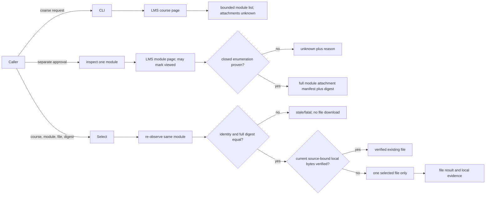

# Phase 18: Selected Materials Contract and Attachment Manifest - Research

**Researched:** 2026-10-09  
**Domain:** Coursemos materials discovery, attachment identity, selected downloads, public CLI/JSON contract  
**Confidence:** MEDIUM — existing path is directly inspected; attachment completeness on live Coursemos pages remains unproven.

<user_constraints>
## User Constraints (from CONTEXT.md)

### Locked Decisions

- **D-18-01:** Publish a versioned materials contract through CLI help, JSON output, `SKILL.md`, and `JSON_CONTRACT.md`. The old unversioned materials mode remains compatible. Unknown contract versions and structurally invalid selection requests fail before effects.
- **D-18-02:** A caller can obtain a bounded coarse course/week/module manifest without visiting individual material pages. It marks the attachment set `unknown` until inspected; LMS completion and planned paths are not saved-file evidence.
- **D-18-03:** Any attachment inspection that can visit a material page and change LMS viewed state is a distinct effect. The CLI exposes this fact, and the caller must approve it before invoking inspection. Inspection returns a complete attachment list only when CoursePilot can prove enumeration; otherwise it returns `unknown` with a reason.
- **D-18-04:** Selected performance names the exact course, module, file ID, and approved full-manifest digest. It re-observes source identity and the complete attachment set before download; an added, missing, renamed, or ambiguous file rejects stale approval before effects. It must never fall back to a whole-course/week download.
- **D-18-05:** Same-week unrelated modules do not block an unchanged approved module. A failed file can be retried alone without executing a verified sibling. Unknown or incomplete attachment sets cannot be reported as complete items.
- **D-18-06:** Selected execution returns per-file status, source identity, saved path, size, and error. Partial failures preserve valid file outcomes; fatal/config/schema errors stop further effects. A repeated selection must avoid duplicate download when current source-bound local evidence proves the file already exists.
- **D-18-07:** Bound source item count, text length, and output size. Treat LMS titles and URLs as data; do not interpolate them into shell commands. Credential values, cookies, and personal course payloads do not enter repository artifacts or diagnostics.
- **D-18-08:** Preserve `materials --course/--week/--dry-run/--json` and the `files` alias for existing callers. New fields are documented with explicit version semantics and fixture-backed normal, partial, stale, and unknown examples.
- **D-18-09:** Publishing the contract is a costly or one-way decision. Before implementation, the executor must present the exact CLI flags and JSON shape for review; then verify the source commit, contract/skill fingerprints, tests, and installed runtime canary. An uninstalled worktree is not proof of a usable contract.

### the agent's Discretion

- Exact names and internal representation of attachment/file IDs, selection arguments, and digest encoding, provided the public version and all invariants above are explicit before the publication checkpoint.
- Parser strategy for supported Coursemos material pages. If a page cannot prove full enumeration without unsafe or unsupported behavior, emit `unknown` instead of fabricating completeness.

### Deferred Ideas (OUT OF SCOPE)

Live account proof is deferred to an explicitly approved scope. Supporting Canvas, Blackboard, VOD, and Notion changes is outside this phase.
</user_constraints>

<phase_requirements>
## Phase Requirements

| ID | Description | Research Support |
|---|---|---|
| MCON-01 | 버전이 명시된 공개 materials JSON 계약으로 과목·주차·자료 목록과 첨부파일 목록의 완전성(complete/unknown)을 구분하고, 상세 조회가 LMS 열람 효과를 낼 수 있음을 호출자에게 알린다. | Coarse discovery boundary, separate inspection effect, proof predicate and unknown reason. [VERIFIED: .planning/REQUIREMENTS.md:52-56] |
| MCON-02 | 승인된 과목·자료·파일 ID와 전체 manifest digest로 정확한 파일 하나를 선택해 실행하며, 새 자료·변경된 첨부·검증된 형제 파일을 묵시적으로 다운로드하지 않는다. | Module-scoped full attachment digest, pre-download re-observation, exact selector. [VERIFIED: .planning/REQUIREMENTS.md:52-56] |
| MCON-03 | 파일별 성공·부분 실패·치명적 오류를 구조화해 반환하고, 실제 저장 파일과 출처를 다시 확인할 증거를 남긴다. 공개 CLI·스킬 계약과 오프라인 fixture가 같은 버전을 증명한다. | File result model, durable source-bound local evidence, contract and fixture parity. [VERIFIED: .planning/REQUIREMENTS.md:52-56] |
</phase_requirements>

## Summary

The existing course page parser can identify material modules without opening their detail pages. Its filter is verbatim `activity.module_type in {"ubfile", "resource"}` (DATA_Q8V4R2N7_START `"ubfile", "resource"` DATA_Q8V4R2N7_END); each `MaterialItem` has one `download_url`, and each legacy `MaterialDownloadResult` has one `saved_path`. [VERIFIED: src/coursepilot/scraper/material_parser.py:19-31; src/coursepilot/materials/models.py:18-46] The downloader's HTML path calls `extract_pluginfile_url`, which returns the first matching anchor/object/iframe/embed URL; it cannot establish that there are no additional attachments. [VERIFIED: src/coursepilot/materials/downloader.py:85-116; src/coursepilot/scraper/material_parser.py:34-61]

Build a versioned selected-materials path alongside the legacy batch path. Coarse discovery must return module identities with attachment completeness `unknown`. Approved inspection may open a module detail page, then either return an evidence-backed complete attachment set or an explicit `unknown` reason. Selected execution must re-observe only the approved module, compare a digest of its **entire** attachment set and source identity, and download only the approved file. This module scope is required so an unrelated same-week module does not invalidate the selected file. [VERIFIED: .planning/phases/18-selected-materials-contract-and-attachment-manifest/18-CONTEXT.md:16-29; .planning/ROADMAP.md:497-507]

The repository's sole materials HTML fixture covers course sections and module links, not attachment-bearing detail pages. Existing downloader tests use isolated HTML snippets and mocks; they do not prove Coursemos attachment completeness. [VERIFIED: tests/fixtures/lms_course_materials.html:18-69; tests/test_material_parser.py:65-91; tests/test_material_downloader.py:130-216] Moodle documents `pluginfile.php` as a file-serving URL and file-area listing as a server-side API, which does not establish a Coursemos browser page's complete attachment list. [CITED: https://docs.moodle.org/dev/File_API] Until a reviewed, representative detail fixture supplies a closed enumeration rule, mark unsupported layouts `unknown` and do not publish a claim of live completeness. [ASSUMED]

Course navigation already calls `validate_activity_coverage` after obtaining a course page, so coarse discovery can reuse that guard. It compares sets of module IDs and the parser deduplicates IDs; selected mode must additionally reject ambiguous duplicate module identity instead of treating that set comparison as proof of uniqueness. [VERIFIED: src/coursepilot/scraper/navigator.py:75-83; src/coursepilot/scraper/course_sections.py:76-97,141-158]

**Primary recommendation:** Plan separate coarse, inspect, and select operations; make complete enumeration a positive proof obligation; publish exact flags and JSON only after the D-18-09 review checkpoint. [VERIFIED: .planning/phases/18-selected-materials-contract-and-attachment-manifest/18-CONTEXT.md:18-35]

## Architectural Responsibility Map

| Capability | Primary Tier | Secondary Tier | Rationale |
|---|---|---|---|
| Coarse manifest | Local CLI/application | LMS course-page read | Reuse course navigation and section parser; do not visit module pages. [VERIFIED: src/coursepilot/materials/runner.py:216-238] |
| Attachment inspection | Local parser/application | LMS module-page read | Approval belongs at CLI boundary; parser returns proven set or unknown. [VERIFIED: .planning/phases/18-selected-materials-contract-and-attachment-manifest/18-CONTEXT.md:19-20] |
| Digest and selection | Local domain/service | LMS re-observation | Compare approved module-scoped attachment set before target file effect. [VERIFIED: .planning/phases/18-selected-materials-contract-and-attachment-manifest/18-CONTEXT.md:21-22] |
| File storage/evidence | Local downloader/storage | LMS file endpoint | Atomic writes exist; new evidence must bind local bytes to source identity. [VERIFIED: src/coursepilot/materials/downloader.py:118-159] |
| Public contract | CLI and published skill | JSON models/tests | Current legacy output has no version envelope. [VERIFIED: src/coursepilot/cli.py:694-795; skills/coursepilot/JSON_CONTRACT.md:99-115] |

## Standard Stack

No package installation is needed for the recommended phase path. The project already declares `click`, `pydantic`, `beautifulsoup4`, `lxml`, `httpx`, `playwright`, and `pytest` (the latter in the dev group); the offline environment probe resolved respectively 8.5.0, 2.13.5, 4.15.0, 6.1.3, 0.28.1, 1.63.0, and 9.1.1. These are **observed local versions**, not a new registry recommendation. [VERIFIED: pyproject.toml:1-35; local `uv run --offline python -c importlib.metadata` probe, 2026-10-09]

| Concern | Use | Reason |
|---|---|---|
| CLI | Existing Click command and `CliRunner` tests | Preserve exact legacy options and `files` alias. [VERIFIED: src/coursepilot/cli.py:694-795; tests/test_cli_materials.py:17-31] |
| Contract models | Existing Pydantic v2 models, separate selected-mode types | Prevent one-file legacy result from implying complete multi-file support. [VERIFIED: src/coursepilot/materials/models.py:18-69] |
| HTML | Existing BeautifulSoup/lxml, with narrow recognized templates | Existing parser already handles course sections and single file discovery. [VERIFIED: src/coursepilot/scraper/material_parser.py:11-61] |
| Network/download | Existing Playwright session and httpx stream/atomic rename | Keep current authenticated infrastructure; constrain selected mode to one source-bound URL. [VERIFIED: src/coursepilot/materials/runner.py:211-257; src/coursepilot/materials/downloader.py:69-159] |
| Digest/evidence | Python standard-library `hashlib`, `json`, and filesystem primitives | Deterministic canonicalization and byte verification need no new dependency. [ASSUMED] |

## Package Legitimacy Audit

No external package install is proposed, so the package legitimacy gate is not triggered. Existing dependency declarations are quoted above from the project manifest. [VERIFIED: pyproject.toml:1-35]

## Architecture Patterns

### System Architecture Diagram



This sequence implements D-18-02 through D-18-06; the exact public names in the diagram are conceptual, pending D-18-09 review. [VERIFIED: .planning/phases/18-selected-materials-contract-and-attachment-manifest/18-CONTEXT.md:18-29]

### Recommended Project Structure

Keep the legacy loop in `materials/runner.py`; add selected-mode manifest/proof and digest functions in focused `materials/` modules, keep Coursemos HTML recognition in `scraper/material_parser.py`, and dispatch new modes in `cli.py`. This is a proposed file responsibility map, not a claim that such modules already exist. [ASSUMED] The current path is `run_materials_pipeline` → `parse_materials_from_course_sections` → `process_course_materials` → `download_material_file`/browser fallback. [VERIFIED: src/coursepilot/materials/runner.py:188-250]

### Pattern 1: Proof-carrying attachment manifest

Represent completeness as an explicit discriminant (`complete` or `unknown`) plus a reason for unknown. Return attachment IDs and a digest only when a **recognized** detail template exposes a closed list with no unresolved viewer, pagination, asynchronous content, ambiguous duplicates, truncation, or hidden child link. Empty HTML or zero matching links alone proves nothing. This proof predicate is a recommendation; the currently inspected fixtures cannot validate its live Coursemos coverage. [ASSUMED] The existing parser returns one URL in ordered priority, not an exhaustive list. [VERIFIED: src/coursepilot/scraper/material_parser.py:34-61]

### Pattern 2: Exact, module-scoped approval

Digest a versioned canonical representation of course ID, module ID/type, module source URL, and **all** enumerated attachment identities, names, and source URLs in stable order. Exclude same-week sibling modules and volatile timestamps. Reject duplicate file IDs and ambiguous source identity before download. The digest must change on added, removed, renamed, or changed attachments. Chosen encoding/normalization must be frozen in the reviewed public contract. [ASSUMED] D-18-04 and D-18-05 require the full approved attachment set and sibling independence. [VERIFIED: .planning/phases/18-selected-materials-contract-and-attachment-manifest/18-CONTEXT.md:21-22]

### Pattern 3: Effect boundary and safe retry

Validate contract version, selector structure, bounds, and approval for view-effectful reinspection before creating an authenticated client or visiting a module. Reobserve the selected module; treat the read itself as the separately approved potential LMS view effect. Compare the full digest, then verify source-bound local evidence or request exactly one selected file. If the reviewed contract permits a batch, every file must appear as its own explicit approved selection; retain valid per-file outcomes when another selected file fails, while fatal validation/stale errors stop further effects. A network response may be inspected for headers but must not be saved before freshness passes. [ASSUMED] Legacy `dry_run` bypasses download/view work while still navigating the course, and legacy normal mode calls `mark_material_viewed` before download. [VERIFIED: src/coursepilot/materials/runner.py:99-149,210-250]

### Anti-Patterns to Avoid

- Inferring attachment count from a filename-like module title, `is_completed`, or a planned `saved_path`. The existing skill already distinguishes LMS completion and planned paths from saved files. [VERIFIED: skills/coursepilot/SKILL.md:65-74,169-174]
- Calling legacy `process_course_materials` after selection. It loops every supplied item and its downloader can follow the first matching link, so an accidental broad filter can fetch siblings. [VERIFIED: src/coursepilot/materials/runner.py:70-85,142-178; src/coursepilot/scraper/material_parser.py:34-61]
- Treating a same-name/same-size local file as source-bound proof. Current duplicate skip uses precisely that comparison, without source identity or a content digest. [VERIFIED: src/coursepilot/materials/downloader.py:135-139,199-202]
- Reusing the whole-course coarse list as the full attachment digest. That would invalidate unchanged selected modules when unrelated same-week modules change. [VERIFIED: .planning/ROADMAP.md:503-506]

## Don't Hand-Roll

| Problem | Avoid | Use Instead | Why |
|---|---|---|---|
| CLI validation/dispatch | Ad hoc argv parsing | Existing Click and `CliRunner` | Existing command and alias behavior are under focused tests. [VERIFIED: src/coursepilot/cli.py:694-795; tests/test_cli_materials.py:17-121] |
| JSON model validation | Untyped dictionaries at effects boundary | Pydantic models with explicit version discriminant | Existing domain model and serialization convention already use Pydantic. [VERIFIED: src/coursepilot/materials/models.py:5-69] |
| HTML parser | Regex-only document scraping | Existing BeautifulSoup/lxml | Current course and viewer parsers use DOM selection. [VERIFIED: src/coursepilot/scraper/material_parser.py:5-61] |
| Authenticated download | New cookie/login machinery | Existing SessionManager, httpx, Playwright | Existing client loads session cookies and browser fallback handles CSMSDoc button. [VERIFIED: src/coursepilot/materials/downloader.py:22-57,162-206] |
| Hash primitive | Custom hash | Standard-library SHA-256 | Digest bytes need deterministic serialization, not new cryptography. [ASSUMED] |

## Common Pitfalls

1. **False `complete`:** A page with one visible `pluginfile.php` link can hide additional files or viewer content. Current tests show one-link extraction, not a closed list. Keep `unknown` unless a supported template's complete enumeration predicate is demonstrated by reviewed fixtures. [VERIFIED: tests/test_material_parser.py:65-91; src/coursepilot/scraper/material_parser.py:34-61] [ASSUMED]
2. **Inspection changes LMS state:** `mark_material_viewed` uses an authenticated GET of the module URL, so another detail GET may have the same effect. Treat both explicit inspection and selected-mode reinspection as potentially effectful and require a visible approval boundary. [VERIFIED: src/coursepilot/materials/downloader.py:60-66] [ASSUMED]
3. **Wrong digest scope:** Hashing all weekly modules causes unrelated additions to block an unchanged approved file; hashing only the chosen file misses new sibling attachments. Hash the selected module's full attachment set. [VERIFIED: .planning/phases/18-selected-materials-contract-and-attachment-manifest/18-CONTEXT.md:21-22]
4. **Wrong file on fallback:** Browser fallback clicks the first download button, and HTML fallback chooses the first pluginfile link. Multi-file selected mode must bind its download action to the chosen file ID or report unknown/ambiguous; do not reuse these paths unguarded. [VERIFIED: src/coursepilot/materials/downloader.py:85-116,162-186]
5. **False duplicate:** Existing skip uses name and byte length; two different sources can have identical names/sizes. Require persisted or freshly computed content evidence tied to selected course/module/file/digest, check actual path containment and bytes before `verified_existing`. [VERIFIED: src/coursepilot/materials/downloader.py:118-159] [ASSUMED]
6. **Unbounded or unsafe source data:** Course/module titles and URLs are LMS-controlled; cap item counts, HTML/text/output length, validate same-origin/allowed endpoint after redirects, sanitize filesystem names, and keep diagnostics free of cookie and personal payload values. [VERIFIED: .planning/phases/18-selected-materials-contract-and-attachment-manifest/18-CONTEXT.md:26-27] [CITED: https://cornucopia.owasp.org/taxonomy/asvs-5.0/05-file-handling/03-file-storage]
7. **Compatibility drift:** Turning `materials` into a Click group can change how bare `materials`, `files`, and existing flags invoke the legacy path. Pin tests for help, stdout shape, and exit codes before dispatch changes. Existing failure exit is `1`; exception exit is `2`. [VERIFIED: src/coursepilot/cli.py:694-795; tests/test_cli_materials.py:17-121]

## Code Examples

### Existing integration seam (source quotation)

```python
DATA_M4C9P6W2_START
materials = parse_materials_from_course_sections(html, c)
target_week, selected_materials = resolve_candidate_materials(materials, week_query)

course_res = process_course_materials(
    course=c,
    materials=selected_materials,
    target_week=target_week,
    output_root=output_root,
    client=client,
    dry_run=dry_run,
    no_download=no_download,
    progress_callback=progress_callback,
    page=page,
)
DATA_M4C9P6W2_END
```

This is the existing batch seam; selected mode should reuse course discovery but branch before `process_course_materials`. [VERIFIED: src/coursepilot/materials/runner.py:235-250]

### Recommended check order (pseudocode, not published contract)

```text
validate version + exact selector + approval + bounds
discover exact course and module without visiting sibling details
inspect selected module; if completeness != complete: stop unknown
canonicalize ALL attachments; compare approved digest and identities
if mismatch or ambiguous: stop stale before file download
verify source-bound local evidence for selected file
otherwise download selected file only; atomically save and verify bytes
emit one result per explicitly selected file plus source/local evidence
```

The check order follows D-18-01 through D-18-06; names and status spelling here are recommendations awaiting the publication review. [VERIFIED: .planning/phases/18-selected-materials-contract-and-attachment-manifest/18-CONTEXT.md:18-29] [ASSUMED]

## State of the Art

| Existing path | Phase 18 path | Impact |
|---|---|---|
| Legacy `MaterialsRunResult` lacks a version envelope; `files` aliases `materials`. [VERIFIED: src/coursepilot/materials/models.py:58-69; src/coursepilot/cli.py:784-795] | Versioned selected-mode envelope while preserving legacy serialization. [VERIFIED: .planning/phases/18-selected-materials-contract-and-attachment-manifest/18-CONTEXT.md:18,28] | A consumer can reject unknown versions without breaking existing callers. |
| First matching pluginfile/viewer button is downloaded. [VERIFIED: src/coursepilot/scraper/material_parser.py:34-61; src/coursepilot/materials/downloader.py:162-186] | Closed enumeration proof, exact file selection, full attachment digest. [VERIFIED: .planning/phases/18-selected-materials-contract-and-attachment-manifest/18-CONTEXT.md:20-22] | Prevents implied selection of other attachments. |
| Same-name/same-size means skipped. [VERIFIED: src/coursepilot/materials/downloader.py:135-139] | Source-bound local evidence before retry skip. [VERIFIED: .planning/phases/18-selected-materials-contract-and-attachment-manifest/18-CONTEXT.md:26] | A skipped result can be audited against current source. |

## Assumptions Log

| # | Claim | Section | Risk if Wrong |
|---|---|---|---|
| A1 | A recognized Coursemos detail template can eventually prove a closed attachment set from accessible HTML or viewer structure. | Summary, Pattern 1 | Runtime may have to report `unknown` for every inspected module until a sanctioned fixture/API is available. |
| A2 | Standard-library canonical JSON plus SHA-256 and an opaque file ID are suitable implementation choices. | Standard Stack, Pattern 2 | The reviewed public contract may choose different encodings. |
| A3 | A locally stored content digest plus source identity is sufficient evidence for safe retry. | Pattern 3, Pitfall 5 | Source content could change at an unchanged URL; the verifier may require a stronger current-source validator or fresh download. |
| A4 | Selected execution should require explicit approval of its reinspection view effect. | Pattern 3, Pitfall 2 | A different approved invocation flow may be chosen at the D-18-09 checkpoint. |
| A5 | A Click group with bare-command legacy callback is the simplest command shape. | Open Questions | The existing alias/flag ordering may favor separate top-level commands. |

## Open Questions (RESOLVED for planning)

1. **RESOLVED — completeness proof:** The repo has a course-section fixture and isolated viewer mocks, not a reviewed multi-attachment detail fixture. [VERIFIED: tests/fixtures/lms_course_materials.html:18-69; tests/test_material_parser.py:65-91; tests/test_material_downloader.py:167-216] Phase 18 must add sanitized closed one-file/two-file fixtures and a positive closed-enumeration predicate for each claimed supported template. Every unsupported or unproven real layout, including an indeterminate CSMSDoc viewer, remains `unknown` with a reason. This resolves the planning rule; it does not claim live Coursemos completeness before an approved evidence run.
2. **RESOLVED — publication decision checkpoint:** CONTEXT delegates exact flags, file ID algorithm, digest fields and JSON shape and requires human review before implementation. [VERIFIED: .planning/phases/18-selected-materials-contract-and-attachment-manifest/18-CONTEXT.md:29-35] Plan 18-01 creates `18-CONTRACT-PROPOSAL.md` with exact syntax, normal/partial/stale/unknown examples, then stops at `checkpoint:decision`. Implementation cannot start before that proposal is approved. The exact public shape remains undecided until that bounded checkpoint, not an implied default.
3. **RESOLVED — existing-file validator:** Name and size alone are not source evidence. [VERIFIED: src/coursepilot/materials/downloader.py:118-139] Plan 18-04 requires a trusted prior receipt binding course/module/file and full manifest digest plus a local byte hash, then checks the current local bytes and freshly observed source identity before `verified_existing`. If either side cannot be established, report `unknown` or perform only an explicitly approved selected download; never silently skip as a verified success.
4. **RESOLVED — selected-mode error mapping checkpoint:** Legacy maps item failures to exit `1` and exceptions to exit `2`. [VERIFIED: src/coursepilot/cli.py:780-791] Plan 18-01's reviewed proposal must freeze selected-mode exit/JSON status mapping before implementation. Plans 18-04/05 must test one parseable bounded JSON object for partial, stale, and fatal domain results, with no credentials or raw personal HTML. Until the checkpoint is approved, no published mapping is asserted.

## Environment Availability

| Dependency | Required By | Available | Version | Fallback |
|---|---|---|---|---|
| Python via `uv` | CLI and tests | Yes | Python 3.14.7; uv 0.12.17 | — [VERIFIED: local `python --version`, `uv --version` probes, 2026-10-09] |
| Existing virtual environment libraries | Parser/CLI/tests | Yes | Versions in Standard Stack | — [VERIFIED: local offline `importlib.metadata` probe, 2026-10-09] |
| Git | source/fingerprint gate | Yes | executable resolved | — [VERIFIED: local `Get-Command git` probe, 2026-10-09] |
| Live LMS/account | runtime proof | Not probed by instruction | — | Offline fixtures; live proof requires separate approval. [VERIFIED: .planning/phases/18-selected-materials-contract-and-attachment-manifest/18-CONTEXT.md:7-9,59-61] |

**Missing dependencies with no fallback:** none identified for offline planning and implementation. Live completeness proof remains a separate evidence gap, not an environment failure. [ASSUMED]

## Validation Architecture

### Test Framework

| Property | Value |
|---|---|
| Framework | Existing pytest, locally 9.1.1. [VERIFIED: pyproject.toml:24-29; local offline metadata probe] |
| Config file | `pyproject.toml` `[tool.pytest.ini_options]` declares `testpaths = ["tests"]`, `pythonpath = ["src"]`, `addopts = "-ra -q"`. (DATA_L5B8D3Q1_START `testpaths = ["tests"]` / `pythonpath = ["src"]` / `addopts = "-ra -q"` DATA_L5B8D3Q1_END) [VERIFIED: pyproject.toml:48-51] |
| Quick run | `uv run --offline python -m pytest tests/test_material_parser.py tests/test_material_downloader.py tests/test_materials_runner.py tests/test_cli_materials.py -q --basetemp <unique-temp-dir>` [VERIFIED: local focused test probe, 2026-10-09] |
| Full run | `uv run --offline python -m pytest -q --basetemp <unique-temp-dir>` [ASSUMED] |

The five focused existing suites, including `test_material_models.py`, passed 34 tests with a unique `--basetemp` on 2026-10-09. A first run also passed assertions but exited during pytest's default Windows temp cleanup with `PermissionError` in a shared temp directory; the unique temp rerun exited 0. [VERIFIED: local pytest probes, 2026-10-09]

### Phase Requirements → Test Map

| Req ID | Behavior | Test Type | Command/File Exists? |
|---|---|---|---|
| MCON-01 | Coarse manifest never visits module detail; inspect approval; complete/unknown proof and bounds | parser/runner/CLI unit | Add focused tests and sanitized detail fixtures: Wave 0. [ASSUMED] |
| MCON-02 | Exact selector; two same-week modules; two files; added/renamed/missing/ambiguous attachment stale rejection before download; one-file retry | unit and offline integration | Add manifest/selected runner tests: Wave 0. [VERIFIED: .planning/ROADMAP.md:503-506] |
| MCON-03 | Per-file partial/fatal result, local bytes/source receipt, legacy serialization, docs examples, installed runtime canary | CLI/unit/package smoke | Extend existing focused suites plus contract snapshot/canary: Wave 0. [VERIFIED: .planning/ROADMAP.md:505-507; tests/test_cli_materials.py:17-121] |

### Sampling Rate

- Per task commit: new focused tests plus the five existing focused suites. [ASSUMED]
- Per wave merge: entire materials-related suite and CLI compatibility tests. [ASSUMED]
- Phase gate: full pytest suite; help/JSON/doc fingerprints; installed runtime canary from a fresh environment without credential read. [VERIFIED: .planning/phases/18-selected-materials-contract-and-attachment-manifest/18-CONTEXT.md:29]

### Wave 0 Gaps

- [ ] Sanitized, reviewed Coursemos detail fixtures for a closed one-file and two-file layout, a viewer/indeterminate layout, duplicate links, changed filename, missing file, and truncation. Current fixture is course-list-only. [VERIFIED: tests/fixtures/lms_course_materials.html:18-69]
- [ ] A contract-version/CLI snapshot matrix that preserves legacy `materials` and `files` behavior. [VERIFIED: tests/test_cli_materials.py:17-121]
- [ ] An offline installed-package probe that reads CLI help and parses selected-mode sample JSON, then compares the installed skill/contract fingerprints to the source commit. [VERIFIED: .planning/phases/18-selected-materials-contract-and-attachment-manifest/18-CONTEXT.md:29]

## Security Domain

Security enforcement is enabled because `.planning/config.json` does not set `security_enforcement: false`; the project handles authenticated LMS cookies and untrusted remote filenames. [VERIFIED: .planning/config.json:1-43; src/coursepilot/materials/downloader.py:22-56,118-129]

### Applicable ASVS 5.0 Categories

| Category | Applies | Control for this phase |
|---|---|---|
| V1 encoding/injection and V2 validation/business logic | Yes | Validate IDs, contract version, digest, counts and URL shape before effects; keep LMS text as data. [CITED: https://cheatsheetseries.owasp.org/IndexASVS.html] |
| V5 file handling | Yes | Sanitized, bounded destination names and root confinement; only one approved file is persisted. [CITED: https://cornucopia.owasp.org/taxonomy/asvs-5.0/05-file-handling/03-file-storage] |
| V6 authentication and V7 session management | Existing boundary | Reuse SessionManager/httpx cookies; do not put cookie values in JSON, logs, receipts, or fixtures. [VERIFIED: src/coursepilot/materials/downloader.py:22-57] [CITED: https://cheatsheetseries.owasp.org/IndexASVS.html] |
| V8 authorization | Yes | Exact course/module/file scope and explicit view-effect approval at CLI boundary; LMS still enforces server-side access. [CITED: https://cheatsheetseries.owasp.org/IndexASVS.html] [ASSUMED] |
| Cryptography | Hashing only | Use a standard digest implementation for deterministic comparison; no custom cryptographic protocol. [ASSUMED] |

### Known Threat Patterns

| Pattern | STRIDE | Mitigation |
|---|---|---|
| Remote filename path escape or overwrite | Tampering | Sanitize name, resolve destination under approved output root, atomic write, verify bytes. [CITED: https://cornucopia.owasp.org/taxonomy/asvs-5.0/05-file-handling/03-file-storage] |
| Redirect to unrelated host or selected-file substitution | Spoofing/Tampering | Bind file ID to source URL and allowlisted LMS origin; recheck redirects and full digest before saving. [ASSUMED] |
| Credential or personal HTML in result/error | Information disclosure | Typed, bounded diagnostic codes; no cookies, credential values, raw LMS payloads in artifacts. [VERIFIED: .planning/phases/18-selected-materials-contract-and-attachment-manifest/18-CONTEXT.md:26-27] |
| Unapproved viewed-state change | Tampering | Separate effect declaration and approval for inspection/reinspection. [VERIFIED: .planning/phases/18-selected-materials-contract-and-attachment-manifest/18-CONTEXT.md:20-21] |

## Sources

### Primary (HIGH confidence)

- Local phase context, roadmap and requirements, 2026-10-09: locked behavior and acceptance criteria. [VERIFIED: .planning/phases/18-selected-materials-contract-and-attachment-manifest/18-CONTEXT.md:7-61; .planning/ROADMAP.md:497-507; .planning/REQUIREMENTS.md:52-56]
- Local source files opened this session: `materials/models.py`, `materials/runner.py`, `materials/downloader.py`, `scraper/material_parser.py`, `scraper/course_sections.py`, and `cli.py`; focused tests and HTML fixture opened this session. [VERIFIED: src/coursepilot/materials/models.py:8-69; src/coursepilot/materials/runner.py:70-281; src/coursepilot/materials/downloader.py:22-206; src/coursepilot/scraper/material_parser.py:11-61; src/coursepilot/scraper/course_sections.py:76-138; src/coursepilot/cli.py:694-795]
- [Moodle File API](https://docs.moodle.org/dev/File_API): generic pluginfile URL and server-side file-area behavior, **not** a Coursemos completeness guarantee. [CITED: https://docs.moodle.org/dev/File_API]
- [OWASP ASVS 5.0 index](https://cheatsheetseries.owasp.org/IndexASVS.html) and [V5.3 file storage](https://cornucopia.owasp.org/taxonomy/asvs-5.0/05-file-handling/03-file-storage): applicable security taxonomy and path validation. [CITED: https://cheatsheetseries.owasp.org/IndexASVS.html] [CITED: https://cornucopia.owasp.org/taxonomy/asvs-5.0/05-file-handling/03-file-storage]

### Tertiary (LOW confidence)

- Web search for official Coursemos `ubfile`/CSMSDoc attachment enumeration yielded no usable authoritative enumeration contract; this is **no observation of a guarantee**, not proof one does not exist. [ASSUMED]

## Metadata

**Confidence breakdown:** Standard stack HIGH (local manifest/environment); existing architecture HIGH (opened source); proposed digest/receipt design MEDIUM (locked behavior, implementation choice pending checkpoint); live attachment completeness LOW (detail fixtures and account proof unavailable); pitfalls HIGH for demonstrated legacy limits, MEDIUM for proposed mitigations. [VERIFIED: pyproject.toml:1-51; src/coursepilot/materials/runner.py:70-281; tests/fixtures/lms_course_materials.html:18-69] [ASSUMED]  
**Research date:** 2026-10-09  
**Valid until:** 2026-11-08 for local-code observations; revisit completeness when sanitized detail evidence or implementation changes arrive. [ASSUMED]
